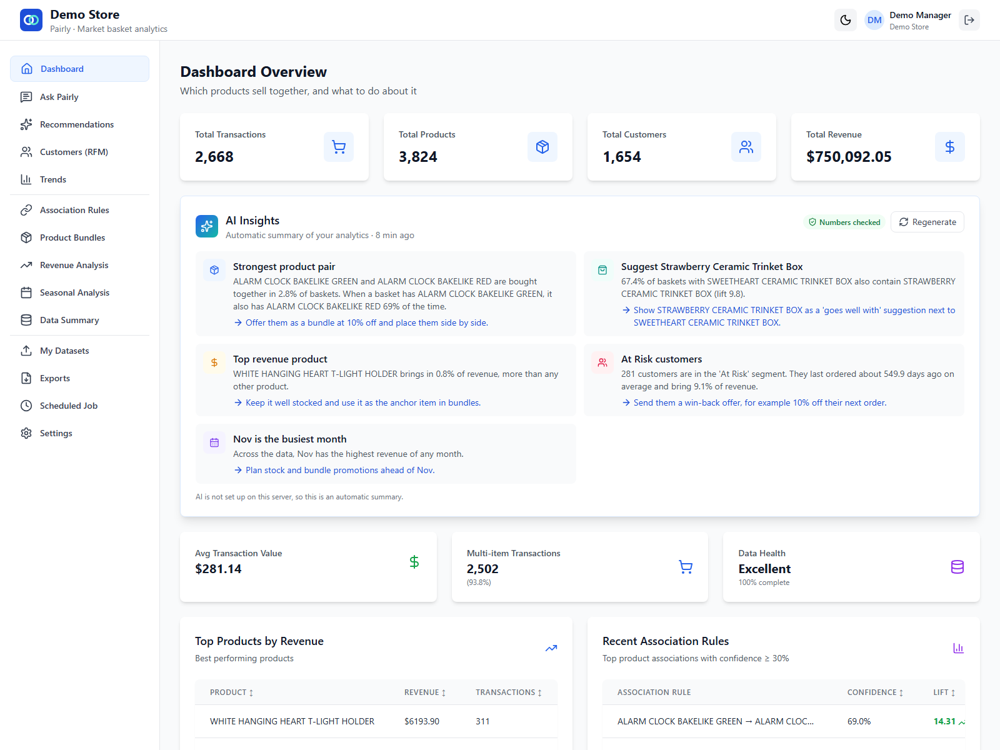
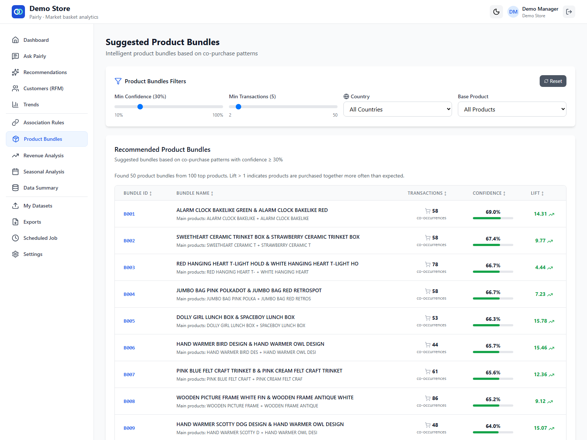
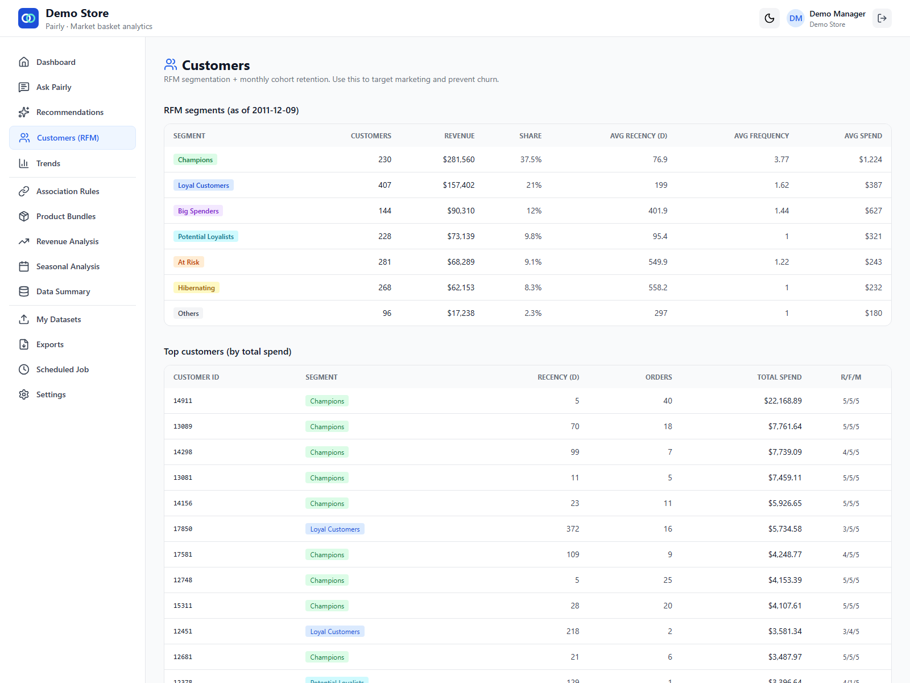

# Pairly

**Find which products sell together, and turn it into bundles and revenue.**

[](https://github.com/ibrahim123-sia/Pairly/actions/workflows/ci.yml)

Pairly is a web app for shop owners. You upload your sales data (CSV or Excel) and Pairly shows:

- which products customers buy together,
- which bundles to offer,
- how revenue moves over the year,
- which customers are loyal and which are slipping away.

An AI layer then explains the results in plain English. It suggests next steps and answers questions such as *"What should I bundle with coffee?"*. The AI never invents numbers: every number comes from Pairly's analytics and is checked before you see it.

Pairly is multi-tenant. A super admin creates stores, and each store manager only ever sees their own store's data.



| Bundles | Product network |
|---|---|
|  |  |
| **Customer segments (RFM)** | **Super admin: AI usage per store** |
|  |  |

## Features

**Analytics**
- **Association rules (Apriori).** "Customers who buy X also buy Y", with support, confidence and lift you can tune.
- **Bundles.** Ready-made product pairs to sell together, plus a discount simulator.
- **Product network.** An interactive graph of which products appear in the same baskets.
- **Recommendations.** The best cross-sell products for any product.
- **Revenue and seasonality.** Revenue by country and year, top products, and peak months, weekdays and hours.
- **Customers.** RFM segments (Champions, At Risk, ...), cohort retention and period-over-period trends.
- **Exports.** PDF reports and CSV files.

**AI features**
- **AI Insights card.** Three to five short insights on the dashboard, each with a suggested action. Every number in the text is checked against the analytics results. If the check fails, Pairly retries once, then shows a template summary instead. Results are cached per store, dataset and thresholds, and a **Regenerate** button makes a fresh set.
- **Ask Pairly.** A chat assistant that answers questions by calling read-only tools: association rules, bundles, product recommendations, revenue breakdown, seasonal trend, RFM segments and top products. Answers stream in, show which tools were used, and say plainly when the data can't answer.
- **Safe by design.**
  - Tools always run on the signed-in user's store. A store id from the model is ignored.
  - Only aggregated results go to the LLM, never customer rows, names or emails.
- **Controls.**
  - AI on/off switch for each store (in Settings) and for the whole platform (super admin).
  - A daily request limit per store.
  - Usage and token counts per store on the super-admin dashboard.
- **Providers.** Groq or Gemini through one OpenAI-compatible gateway, chosen with env vars. Without a key, Pairly still works and shows template summaries.

**Platform**
- Stores, store managers and a super admin, with JWT sign-in, password reset and an audit log.
- Each store's data is isolated. Every endpoint resolves the store on the server.
- Scheduled re-analysis with email summaries.

## Tech stack

| Part | Tools |
|---|---|
| Backend | Python 3.12, FastAPI, SQLAlchemy 2, Alembic, PostgreSQL (or SQLite) |
| Analytics | pandas, NumPy, mlxtend (Apriori), ReportLab (PDF) |
| AI | Groq or Gemini via an OpenAI-compatible API (httpx), tool calling, Server-Sent Events |
| Frontend | React 19, Vite 7, Tailwind CSS 3, Recharts, react-force-graph |
| Quality | pytest (with a mock LLM), Ruff, ESLint, GitHub Actions |
| Deploy | Cloudflare Workers + Containers + R2 + Cron Triggers, managed PostgreSQL (Neon or PlanetScale), Docker, docker compose |

## Quick start

### Option 1: Docker (everything in one command)

You need Docker Desktop (or Docker Engine with compose).

```bash
git clone https://github.com/ibrahim123-sia/Pairly.git
cd Pairly
docker compose up --build
```

Open <http://localhost:8080>. This starts PostgreSQL, the API and the web app, and loads the demo data. API docs are at <http://localhost:5000/docs>.

To turn on the AI features, create a file named `.env` next to `docker-compose.yml` with `GROQ_API_KEY=your-key` (or `GEMINI_API_KEY=...`), then run `docker compose up` again.

### Option 2: Run it yourself

You need Python 3.10+ and Node.js 20.19+ (or 22). The backend uses SQLite unless you set `DATABASE_URL`.

**1. Backend** (from the repo root)

macOS / Linux:

```bash
cd backend
python3 -m venv .venv
source .venv/bin/activate
pip install -r requirements.txt
cp .env.example .env
alembic upgrade head
python scripts/seed_demo.py
python run.py
```

Windows (PowerShell):

```powershell
cd backend
py -m venv .venv
.venv\Scripts\Activate.ps1
pip install -r requirements.txt
Copy-Item .env.example .env
alembic upgrade head
python scripts/seed_demo.py
python run.py
```

If PowerShell blocks `Activate.ps1`, run `Set-ExecutionPolicy -Scope CurrentUser RemoteSigned` once, or use Command Prompt with `.venv\Scripts\activate.bat`.

The API runs on <http://localhost:5000> (docs at `/docs`).

**2. Frontend** (in a second terminal, same commands on every OS)

```bash
cd frontend
npm install
npm run dev
```

Open <http://localhost:5173>. Vite forwards `/api` to the backend.

**3. AI (optional).** Put `GROQ_API_KEY=...` or `GEMINI_API_KEY=...` in `backend/.env` and restart the backend.

### Configuration

All settings are environment variables. The full list with comments is in [`backend/.env.example`](backend/.env.example) and [`frontend/.env.example`](frontend/.env.example). The main ones:

| Variable | What it does |
|---|---|
| `APP_ENV` | `development` or `production`. Production refuses to start with the example secrets. |
| `APP_DEBUG` | Auto-reload in development (default `true`). `FLASK_ENV` / `FLASK_DEBUG` still work as fallbacks. |
| `SECRET_KEY`, `JWT_SECRET_KEY` | Signing secrets; use long random strings |
| `DATABASE_URL` | PostgreSQL URL; empty means a local SQLite file |
| `DATA_DIR` | Where uploaded datasets and exports are stored |
| `FRONTEND_URL` | Web app address, used in emails and always allowed by CORS |
| `ALLOWED_ORIGINS`, `ALLOWED_ORIGIN_REGEX` | Extra CORS origins, and a regex for preview deploys |
| `SUPER_ADMIN_EMAIL`, `SUPER_ADMIN_PASSWORD` | The super admin created on startup |
| `LLM_PROVIDER`, `GROQ_API_KEY`, `GEMINI_API_KEY`, `LLM_MODEL` | AI provider and model (all optional) |
| `AI_ENABLED`, `AI_DAILY_REQUEST_LIMIT` | Default platform AI switch and requests per store per day |
| `MAIL_*` | SMTP settings; `MAIL_SUPPRESS_SEND=true` logs emails instead of sending them |
| `STORAGE_BACKEND`, `R2_*` | `r2` keeps uploaded datasets in a Cloudflare R2 bucket as well as on disk (default `local`) |
| `SCHEDULER_MODE`, `CRON_SECRET` | `external` runs scheduled jobs from a Cron Trigger instead of in-process (default `internal`) |
| `VITE_API_BASE_URL` (frontend) | Full API URL when the API is on another domain, e.g. `https://api.example.com/api` (not needed on Cloudflare, where both share one address) |

## Demo logins

After `python scripts/seed_demo.py` or `docker compose up`:

| Role | Email | Password |
|---|---|---|
| Store manager (Demo Store) | `demo@example.com` | `Demo@12345` |
| Super admin | `admin@example.com` | `Admin@12345` |

These are local demo accounts. On a public deployment, set your own `SUPER_ADMIN_PASSWORD` (production refuses the example one) and share only the store manager login.

The seed loads `backend/app/demo/sample_transactions.csv` (see [Demo data](#demo-data)). To load another file: `python scripts/seed_demo.py --file path/to/file.csv`.

## Project structure

```
Pairly/
├── backend/
│   ├── app/
│   │   ├── main.py             # FastAPI app, CORS, routers
│   │   ├── config.py           # settings from environment variables
│   │   ├── database.py         # SQLAlchemy engine and session
│   │   ├── dependencies.py     # auth and store scoping
│   │   ├── schemas.py          # request and response models
│   │   ├── models/             # SQLAlchemy models (incl. AI tables)
│   │   ├── routers/            # auth, admin, store, analytics, ai, internal, health
│   │   ├── services/           # analytics, datasets, email, exports, storage, scheduler
│   │   │   └── ai/             # LLM gateway, number check, tools, insights, assistant
│   │   ├── utils/
│   │   ├── templates/email/    # email templates (Jinja2)
│   │   └── demo/               # sample_transactions.csv (4.6 MB demo data)
│   ├── migrations/             # Alembic
│   ├── scripts/                # seed_demo.py, make_sample.py
│   ├── tests/                  # pytest (mock LLM, no network) + fixtures/
│   ├── run.py · alembic.ini · pyproject.toml
│   ├── requirements.txt · requirements-dev.txt
│   ├── Dockerfile · .dockerignore · docker-entrypoint.sh
│   └── .env.example
├── frontend/
│   ├── src/
│   │   ├── api/                # axios client + one module per area
│   │   ├── components/         # shared UI, incl. AI Insights card
│   │   ├── context/            # auth and theme
│   │   ├── layouts/            # store, admin and sign-in layouts
│   │   ├── pages/              # analytics/, store/, admin/, auth/
│   │   └── routes/             # route guards
│   ├── public/
│   ├── nginx/                  # nginx config for the Docker image
│   ├── Dockerfile · vite.config.js
│   └── .env.example
├── cloudflare/                 # Worker + wrangler.jsonc: web app, API container, cron
├── .github/                    # CI and deploy workflows, README screenshots
├── docker-compose.yml
└── README.md · CHANGELOG.md · SECURITY.md · LICENSE
```

## Tests

```bash
# backend (from backend/)
pip install -r requirements-dev.txt
ruff check .
pytest

# frontend (from frontend/)
npm run lint
npm run build
```

Backend tests use a temporary database and a mock LLM, and block all network access, so they never call a real API. They cover:

- the API and the market basket math,
- exact rules and bundles from a small fixture with planted product pairs,
- the number check,
- tool store scoping (store A can never read store B),
- the template fallback,
- the chat stream,
- the AI switches and limits.

GitHub Actions runs everything on each push and pull request: the tests on SQLite and on PostgreSQL, the migrations, a full `docker compose` start, and a dry run of the Cloudflare Worker.

## Deployment

Pairly runs on **Cloudflare**, with a managed **PostgreSQL** database:

```
Browser ──> Cloudflare Worker "pairly" ──┬── React web app (static files)
                                         └── /api ──> Container: FastAPI ──┬── PostgreSQL (Neon or PlanetScale)
                                                                           ├── R2 bucket (uploaded datasets)
                                                                           └── Groq, Gemini as fallback
Cron Trigger (hourly) ──> /api/internal/scheduled-jobs/run
```

- One Worker serves the web app and forwards `/api` to the API container. Everything is on one address, so no CORS setup is needed.
- The container's disk is wiped when it sleeps. Uploaded datasets are therefore also kept in R2 and come back automatically.
- The config is in [`cloudflare/`](cloudflare/). The deploy runs from GitHub Actions, so you don't need Docker on your PC.

### What you need

| Account | Plan | Used for |
|---|---|---|
| [Cloudflare](https://dash.cloudflare.com) | Workers Paid, $5/month (Containers require it) | Worker, Container, R2, Cron |
| [Neon](https://neon.tech), or PlanetScale through Cloudflare | Neon: Free | PostgreSQL (pick one, see below) |
| [Groq](https://console.groq.com) / [Google AI Studio](https://aistudio.google.com) | Free tier | AI (optional; Gemini is the fallback) |

### 1. Create the services (once)

1. **PostgreSQL:** Cloudflare does not run PostgreSQL itself, so pick one of these. Pairly only needs the connection string as `DATABASE_URL`, so you can switch later without code changes.
   - **Neon (free):** create a project, open *Connect*, choose the **pooled** connection string and copy it (it ends with `sslmode=require`).
   - **PlanetScale Postgres (paid, on your Cloudflare bill):** create the database from the Cloudflare dashboard ([guide](https://developers.cloudflare.com/hyperdrive/planetscale/)), then copy its PostgreSQL connection string with `sslmode=require`.
2. **R2:** in Cloudflare, go to *R2 → Create bucket* and name it `pairly-data`. Then open *Manage API tokens → Create API token* with **Object Read & Write** on that bucket, and copy the *Access Key ID* and *Secret Access Key*.
3. **Cloudflare API token:** go to *My Profile → API Tokens → Create Token*, use the **Edit Cloudflare Workers** template and limit it to your account. Copy the token and your **Account ID** (shown on the dashboard). If a deploy fails while pushing the container image, add the *Containers: Edit* permission to the token.

### 2. Add the secrets to GitHub

In the repo, open *Settings → Secrets and variables → Actions → New repository secret*:

| Secret | Value |
|---|---|
| `CLOUDFLARE_API_TOKEN` | The token from step 1.3 |
| `CLOUDFLARE_ACCOUNT_ID` | Your Cloudflare account id |
| `DATABASE_URL` | The PostgreSQL connection string from step 1.1 |
| `R2_ACCESS_KEY_ID`, `R2_SECRET_ACCESS_KEY` | From the R2 API token |
| `SECRET_KEY`, `JWT_SECRET_KEY`, `CRON_SECRET` | Three different random strings: `python -c "import secrets; print(secrets.token_urlsafe(48))"` |
| `SUPER_ADMIN_EMAIL`, `SUPER_ADMIN_PASSWORD` | Your admin login (production refuses the demo password) |
| `GROQ_API_KEY`, `GEMINI_API_KEY` | Optional, for the AI features |
| `MAIL_SERVER`, `MAIL_PORT`, `MAIL_USERNAME`, `MAIL_PASSWORD`, `MAIL_DEFAULT_SENDER` | Optional, to send real emails; also set `MAIL_SUPPRESS_SEND` to `"false"` in `cloudflare/wrangler.jsonc` |

### 3. Deploy

Go to *Actions → Deploy to Cloudflare → Run workflow*. The workflow builds the web app, builds and pushes the API image, deploys the Worker, and uploads the secrets. The app then runs at `https://pairly.<your-subdomain>.workers.dev`, with the demo store loaded.

Afterwards:
- Put that address in `FRONTEND_URL` in [`cloudflare/wrangler.jsonc`](cloudflare/wrangler.jsonc); it's used in emails. Then run the workflow again.
- A custom domain is optional: *Workers → pairly → Settings → Domains & Routes*.
- Deploying from your own PC also works (needs Docker Desktop): `cd cloudflare`, `npm install`, `npx wrangler login`, `npm run deploy`, then `npx wrangler secret put NAME` for each secret.

### Good to know

- **Cold starts.** The API container sleeps after 10 minutes without traffic. The first request after that takes up to about a minute while it starts and runs migrations.
- **Costs.** The $5 plan includes 25 GiB-hours of container memory each month. The API uses the `basic` size (1 GiB) and only bills while awake. The hourly job check keeps it awake about 10 minutes per hour, which comes to roughly $1 a month extra. To check once a day instead, change `triggers.crons` in `wrangler.jsonc` to `"0 2 * * *"`. R2 and Neon stay within their free tiers for a demo.
- **Big datasets** (hundreds of thousands of rows): change `instance_type` to `"standard-1"` (4 GiB) in `wrangler.jsonc`.
- **Logs:** run `cd cloudflare && npx wrangler tail`, or open *Workers → pairly → Logs*.

## Demo data

Pairly works on each store's own sales data, uploaded as CSV or Excel on the **My Datasets** page. The repo has two small files for the demo and the tests; no other data is tracked.

| File | What it is |
|---|---|
| `backend/app/demo/sample_transactions.csv` | About 57,000 rows (2,668 whole invoices, 4.6 MB), loaded into the demo store by `scripts/seed_demo.py` |
| `backend/tests/fixtures/transactions_small.csv` | 315 hand-designed rows with planted product pairs, so tests can check exact rules and bundles (`tests/fixtures/make_fixture.py`) |

**Attribution.** The demo sample comes from the **Online Retail II** dataset by Daqing Chen, UCI Machine Learning Repository, <https://archive.ics.uci.edu/dataset/502/online+retail+ii>, [doi:10.24432/C5CG6D](https://doi.org/10.24432/C5CG6D), licensed under [CC BY 4.0](https://creativecommons.org/licenses/by/4.0/). It covers transactions from a UK online gift shop between December 2009 and December 2011.

**Changes made.** Cancelled invoices and rows with no price, quantity or customer ID were removed. Then 8% of invoices were picked at random (seed 42), keeping every line of each chosen invoice, and columns Pairly computes itself were dropped. To rebuild it from a full cleaned export: `python scripts/make_sample.py --source path/to/Online_Retail_II_Cleaned.csv`.

## License

Proprietary. Copyright 2026 Syed Ibrahim Ali, all rights reserved. See [LICENSE](LICENSE). The dataset keeps its own CC BY 4.0 licence.
