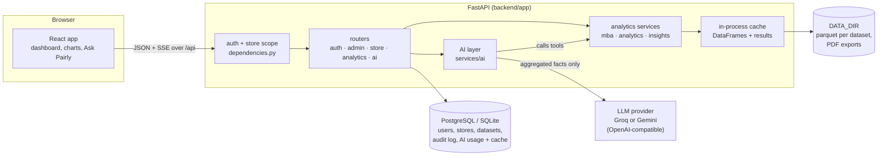
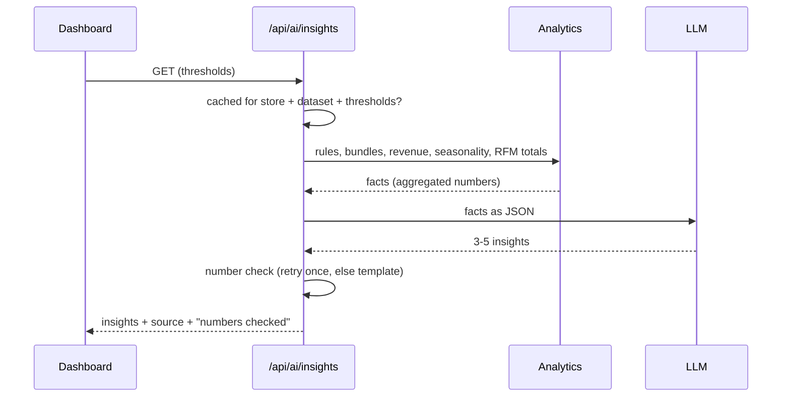
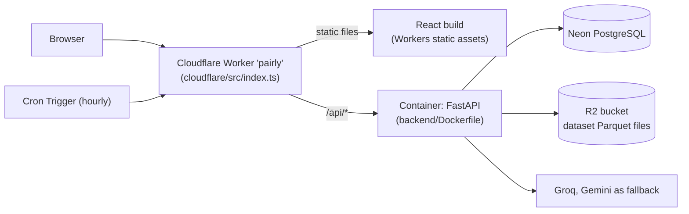

# Pairly architecture

Pairly has two parts: a **React** single-page app and a **FastAPI** service. The API holds all data and does all the analysis. The AI layer sits on top of the analytics: it explains results, but it never produces numbers of its own.

## Request flow

1. The browser signs in and gets a JWT access token and a refresh token.
2. Every store endpoint resolves the store **on the server** from the signed-in user (`get_current_store`). A super admin picks a store with `?store_id=`. A store manager can only ever reach their own store.
3. An uploaded CSV/Excel file is cleaned, column names are mapped, and the result is saved as Parquet in `DATA_DIR/stores/<id>/datasets/`. The dataset row in the database points at that file.
4. The analytics endpoints load the store's active dataset (with an LRU cache of DataFrames) and run pandas + mlxtend. Results are cached per store, dataset and query.

## Analytics (`backend/app/services`)

| Service | What it computes |
|---|---|
| `mba_service` | Apriori frequent itemsets, association rules, bundles, the product network |
| `analytics_service` | Summary KPIs, revenue by country, top products, seasonal patterns |
| `insights_service` | Cross-sell recommendations, RFM segments, period comparison, cohorts, bundle simulator |
| `export_service` | PDF (ReportLab) and CSV exports |

## AI layer (`backend/app/services/ai`)

The rule: **the analytics code computes every number; the AI only explains results and picks which tools to call.**

| Module | Role |
|---|---|
| `llm_gateway.py` | One OpenAI-compatible client for Groq and Gemini, chosen by env vars. Timeouts and one retry. |
| `number_check.py` | Checks that every number in AI text appears in the data the AI was given. |
| `insights.py` | The dashboard's AI Insights card: facts → LLM → number check → one retry → template fallback. Cached per store + dataset + thresholds. |
| `tools.py` | Seven read-only tools that wrap the analytics services. The store comes from the server-side context, never from the model. |
| `assistant.py` | "Ask Pairly": a tool-calling loop, streamed to the browser as Server-Sent Events. |
| `usage.py` | On/off switches (platform, per store by the admin, per store by the manager), the daily limit and the usage log. |

**Insights card**

**Ask Pairly**

1. The browser posts the conversation (user and assistant text only) to `/api/ai/chat`.
2. The model may call tools such as `get_bundles` or `get_rfm_segments`. Each call runs on the signed-in user's store. Arguments the tool does not declare, like `store_id`, are dropped.
3. Tool results go back to the model, which writes the answer. The answer streams to the browser as `token` events, with `tool_start` / `tool_end` events so the UI can show which tools ran.
4. A final `done` event reports whether every number in the answer matched the tool results.

**Privacy.** Only aggregated results (rules, bundle stats, segment totals) are sent to the LLM. Tools never return customer ids, names or emails, and a last-step scrubber removes customer keys from any result.

## Data model

Existing tables: `users`, `stores`, `datasets`, `audit_logs`, `password_reset_tokens`, `scheduled_jobs`.

AI tables (migration `3678ef73e299`, all new):

| Table | Holds |
|---|---|
| `platform_settings` | The super admin's global AI switch |
| `store_ai_settings` | Per-store manager switch, admin block and daily limit |
| `ai_usage_logs` | One row per AI request: feature, provider, model, tokens, status |
| `ai_insight_cache` | Generated insights per store + dataset + thresholds |

Schema changes go through Alembic (`backend/migrations`). The app also runs `create_all()` on startup, so a fresh local SQLite database works without running migrations.

## Frontend (`frontend/src`)

- `api/`: an axios client with token refresh, plus one module per area. `aiApi.streamChat` reads the SSE stream with `fetch`.
- `layouts/`: separate layouts for the store manager, the super admin and the sign-in pages.
- `pages/`: analytics pages (Dashboard, Association Rules, Bundles, Network, Revenue, Seasonal), store pages (Ask Pairly, Recommendations, Customers, Trends, Datasets, Exports, Settings) and admin pages.
- `components/AIInsightsCard.jsx` and `pages/store/AskPairly.jsx` are the AI UI. `components/AdminAIPanel.jsx` is the usage panel on the super-admin dashboard.

## Deployment shape

- **One address.** The Worker serves the React build itself and forwards only `/api/*`, `/docs` and `/openapi.json` to the container, so the browser never makes a cross-origin call.
- **One container instance** (a named Durable Object) runs the API. It sleeps after 10 idle minutes. On a cold start it runs `alembic upgrade head`, starts serving, and restores the demo store in the background.
- **The disk is temporary.** Container disks are wiped on sleep, so with `STORAGE_BACKEND=r2` every uploaded dataset is also written to R2 and downloaded again on first use (`app/services/storage.py`).
- **Scheduled jobs.** With `SCHEDULER_MODE=external` the in-process scheduler is off. The Cron Trigger calls `POST /api/internal/scheduled-jobs/run` with the `X-Cron-Secret` header, and the API runs the store jobs that are due.
- **Settings.** Plain settings live in `cloudflare/wrangler.jsonc` (`vars`). Secrets are set with `wrangler secret`, or by the "Deploy to Cloudflare" GitHub workflow. The Worker passes both to the container as environment variables.

Locally, `docker compose up` runs the same API image next to PostgreSQL, with nginx serving the React build and forwarding `/api`. There, files stay on a Docker volume and APScheduler runs in-process.
